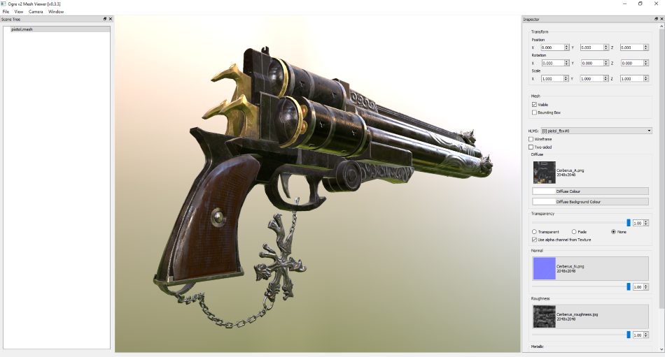

# Ogre3D mesh viewer/converter

A Ogre3D mesh viewer based on Ogre-Next (v2.2+ texture system) which can import obj/gltf models.

 [Download Windows x64](https://github.com/chchwy/ogre-v2-mesh-viewer/releases)



## Features

- Load Ogre v2, v1, xml meshes with HLMS materials.
- Import Wavefront Obj (with its `.mtl` materials and textures) and save as Ogre Meshes
- Import glTF 2.0 models and save as Ogre Meshes
  - Skinning is not supported; normal maps are ignored on meshes without tangents
- Import DotScene (`.scene`) files: node hierarchy and meshes (lights and cameras are skipped)
- Export the scene to Wavefront Obj or glTF 2.0 (`.glb` / `.gltf`), with materials and textures
- Show scene hierarchy
- Basic HLMS editing
  - Texture: diffuse, normal, roughness, metalness, emissive
  - Colour: diffuse, background diffuse, specular, emissive
  - Transparent value and mode
  - Solid or wireframe
  - Two-sided on/off
- Scene node editing:
  - Position, rotation and scale
  - Show/hide bounding boxes
  - Switch visibility
- Batch conversion tool: obj => .mesh and .mesh => obj
- Save a screenshot of the view (`F12`)

## Command line

```
ogre-v2-mesh-viewer.exe [files...] [--export <file>] [--screenshot <file.png>]
```

- `files`: models to load at startup (`.mesh`, `.mesh.xml`, `.obj`, `.gltf`, `.glb`, `.scene`).
- `--export`: write the loaded models to a `.obj`, `.glb` or `.gltf` file, then quit.
- `--screenshot`: save a picture of the view, then quit.

## How to compile

1. Have the Qt SDK installed (developed against Qt 6.8 with MSVC 2022; Qt 5.15 should still work), download it [here][0].
2. Build [ogre-next](https://github.com/OGRECave/ogre-next) (master / 4.0) and its dependencies, then run the `INSTALL` target so you get an sdk folder.
   - On a non-English Windows, add `/utf-8` to `CMAKE_CXX_FLAGS`, otherwise MSVC misreads some ogre-next sources.
3. Set the path to the Ogre sdk folder. You can either set an user-level `OGREHOME` environment variable, or set it directly in `ogre-v2-mesh-viewer.pro`.
4. Open `ogre-v2-mesh-viewer.pro` in QtCreator and press `RUN`.
5. Run `deploy.bat` to copy the Ogre and Qt DLLs next to the executable.

[0]: https://www.qt.io/download-qt-installer "Qt download"

## TODO

- [ ] More HLMS material editing: detail maps, UV sets, sampler settings
- [ ] glTF skinning and animation
- [ ] DotScene lights and cameras
- [x] Batch convertor from mesh to obj
- [x] glTF export
- [x] Support DotScene
- [x] Improve performance by converting obj data to ogre mesh directly
- [x] Automatically generate normals if there are no normal vectors in obj
- [x] glTF import

## Known issues

- [ ] Block-compressed textures (e.g. BC/DXT `.dds`) have no preview on the material panel and are not exported

## Acknowledgements

- Ogre3D: <https://www.ogre3d.org/>
- Qt: <https://www.qt.io/>
- Magus Toolkit: <https://github.com/spookyboo/Magus>
- tinyobjloader: <https://github.com/syoyo/tinyobjloader>
- Ogre glTF: <https://github.com/Ybalrid/Ogre_glTF>
- tinygltf: <https://github.com/syoyo/tinygltf>
- PBR Pistol: <http://artisaverb.info/PBT.html>
